  

<h1 align="center">Hi! I'm Lopes</h1>

<h3 align="center">Desenvolvedor Back-end em formação</h3>

  

Construindo sistemas que resolvem problema de verdade, um commit de cada vez.

<h2 align="center">🚀 Sobre mim</h2>

Sou o **Luis Fernando Lopes**, estudante de Análise e Desenvolvimento de Sistemas no IFRS – Campus Erechim, com o foco em **back-end** e **DevOps**.

Antes do código vieram a contabilidade, a manutenção industrial pelo SENAI e a edição de vídeo.

No momento estou me aprofundando em **Java, Spring Boot e Docker**, e desenvolvendo projetos pelo caminho, tanto para aprendizado quanto para portfólio.

Fora do teclado, toco guitarra.

 

<h2 align="center">🤝 Conecte-se</h2>

  

<h2 align="center">💻 Tech Stack</h2>

  

  

<h2 align="center">📊 GitHub Stats</h2>

<h2 align="center">⌘ Commits</h2>

<picture>
  <source media="(prefers-color-scheme: dark)" srcset="https://raw.githubusercontent.com/lopesVE/lopesVE/output/pacman-contribution-graph-dark.svg">
  <source media="(prefers-color-scheme: light)" srcset="https://raw.githubusercontent.com/lopesVE/lopesVE/output/pacman-contribution-graph.svg">
  
</picture>

<h2 align="center">⌘ Filosofia</h2>

  

